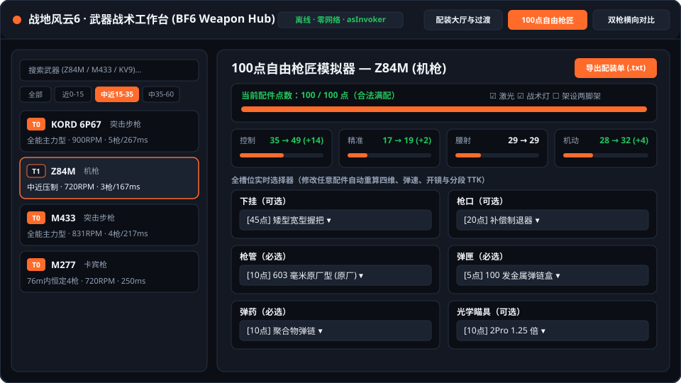
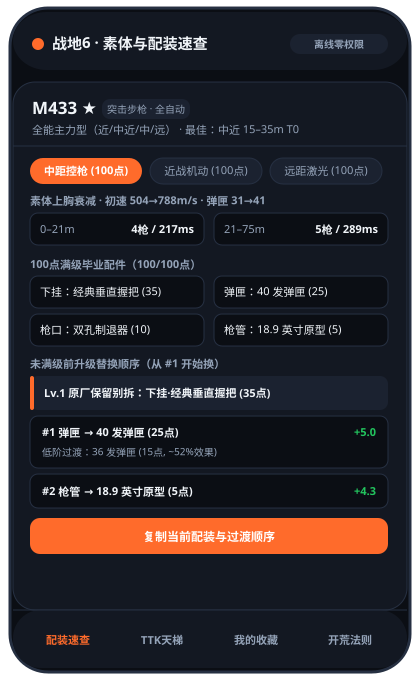

# BF6 Weapon Hub · 战地风云6素体分类与双端配装工具

基于客户端解包弹道数据与枪匠底层计算公式（覆盖全部 **69 把可改装武器** 与 **6000+ 配件词条**），按真实交战距离对每把枪的素体进行定性与分级，并提供 **100 点满级毕业方案** 与 **未满级前的低点数配件过渡路线**。

本项目针对不同使用场景提供两个完全离线、最小权限的独立客户端：**手机端单手速查软件** 与 **Windows 电脑端战术工作台**。

---

## 一、项目目的

在《战地风云 6》的 100 点枪匠预算体系下，配枪存在三个高频痛点：
1. **常规枪管/枪口不改变伤害衰减断点**：一把枪适合打 0–15m 还是 35–60m，80% 由原厂素体伤害曲线与后坐底子决定，盲目给近战枪堆远射程属于扬短避长。
2. **未满级前开荒迷茫**：顶级握把（35–45 点）与补偿制退器（20 点）普遍在高熟练度等级才解锁，新手期不知道哪些 1 级原厂高阶件应该保留、哪些低点数配件能平替过渡。
3. **外部工具臃肿或存在反作弊顾虑**：传统桌面助手常伴随后台联网、管理员权限请求或游戏内覆盖层注入。

**BF6 Weapon Hub** 通过还原游戏底层四维（控制 / 精准 / 腰射 / 机动）与计入子弹飞行延迟的真实分段 TTK 模型，在**零网络请求、零敏感权限、与游戏进程 100% 物理隔离**的前提下解决上述问题。

---

## 二、界面预览

### 1. 电脑端战术工作台（Windows 单文件免安装 `.exe`）
支持全武器距离/枪种/Tier 筛选、**100点全槽位自由枪匠实时重算**（含激光 / 战术灯 / 两脚架状态切换）、**双武器各距离真实 TTK 同屏横向对比**与副屏窗口置顶。

<p align="center">
  
</p>

### 2. 手机端单手速查伴侣（离线 PWA & 零权限 Android APK）
针对对局阵亡/复活间隙的单手操作设计：底部拇指导航、上滑详情抽屉卡、一键切换流派、查看低阶过渡阶梯与本地星标收藏。

<p align="center">
  
</p>

---

## 三、双端职责边界与最小权限设计

详见安全白皮书 [SECURITY.md](./SECURITY.md)。

| 对比维度 | 手机端软件（Mobile PWA + Android APK） | 电脑端程序（`BF6WeaponHub.exe`） |
|---|---|---|
| **使用场景** | 对局间隙 **单手 3 秒速查**：查距离 Tier、抄满级配件、看未满级先解锁哪件、本地收藏常用枪。 | 开局前 **大屏深度研究**：100 点自由拼装实时重算、双枪 5–100m 实战 TTK 同屏对比、副屏置顶对照。 |
| **功能边界** | 纯只读速查与本机收藏；不引入复杂多列大表；零外部 CDN、零第三方字体与统计脚本。 | 不枚举或读取游戏进程、不挂全局键鼠钩子、不做 DirectX/Vulkan 画面注入，与反作弊系统完全隔离。 |
| **最小权限** | **0 系统权限**：Android 版 `AndroidManifest.xml` 无任何 `<uses-permission>`（**连 `INTERNET` 联网权限都不申请**）；PWA 版锁定 `default-src 'none'` 严苛 CSP，断网/飞行模式可用。 | **普通用户最低权限**：嵌入 `asInvoker` 清单**禁止管理员 UAC 提权**；全量数据包内嵌于 ~400 KB 单文件 `.exe` 内存解压，**零网络代码、启动运行零写盘**。 |

---

## 四、下载与使用方式

### 电脑端（Windows 10 / 11）
- **直接运行**：前往仓库右侧 **Releases** 页面下载 `BF6WeaponHub.exe`，无需安装任何额外运行库，双击即可打开。
- **从源码构建**（仅依赖 Windows 系统自带的 `.NET Framework` 编译器）：
  ```powershell
  powershell -ExecutionPolicy Bypass -File ./desktop-win/build.ps1
  ```
  编译产物生成于 `./dist/BF6WeaponHub.exe`，构建脚本会自动执行 `--self-test` 内存计算自检。

### 手机端（iOS & Android）
- **离线 PWA 应用（iOS / Android 通用）**：通过浏览器访问本项目部署的 GitHub Pages 页面，在 Safari（分享 → 添加到主屏幕）或 Chrome/Edge（菜单 → 安装应用）中添加后，即可作为独立全屏离线 App 运行。
- **零权限 Android 安装包**：前往 **Releases** 下载 `BF6WeaponHub-Android-ZeroPerm.apk` 安装（系统应用权限页可验证显示为“未请求任何权限”）。

### 在线图文手册
- 如需直接查阅 Markdown 版本的全 69 把武器分类总表与单枪详解，请阅读 [docs/WEAPON_GUIDE.md](./docs/WEAPON_GUIDE.md)。

---

## 五、目录结构

```text
├── .github/workflows/     # 自动部署 Pages 与自动编译 EXE / 零权限 APK 流水线
├── data/                  # 预打包的手机端只读数据与桌面端全量枪匠压缩包
├── desktop-win/           # Windows C# WPF 原生单文件工作台源码与 asInvoker 清单
├── mobile-pwa/            # 零外部依赖的渐进式离线手机应用
├── mobile-android/        # 零权限原生 Android WebView 离线封装工程
├── docs/                  # 界面示例图与全 69 把武器图文速查手册
├── tools/pack_data.py     # 数据打包构建脚本
└── SECURITY.md            # 最小权限与安全边界说明
```

---

## 免责声明与数据致谢

- 武器基础弹道与配件解包参数参考社区数据站 [BF6 Tracker](https://battlefield6tracker.com/zh/weapons)（数据版本 `2026-11-10`），本项目为非官方开源攻略与计算工具，与 EA / DICE 无关。
- 本项目所有客户端均为独立外部静态资料查询与数学计算器，不与游戏客户端产生任何交互。
